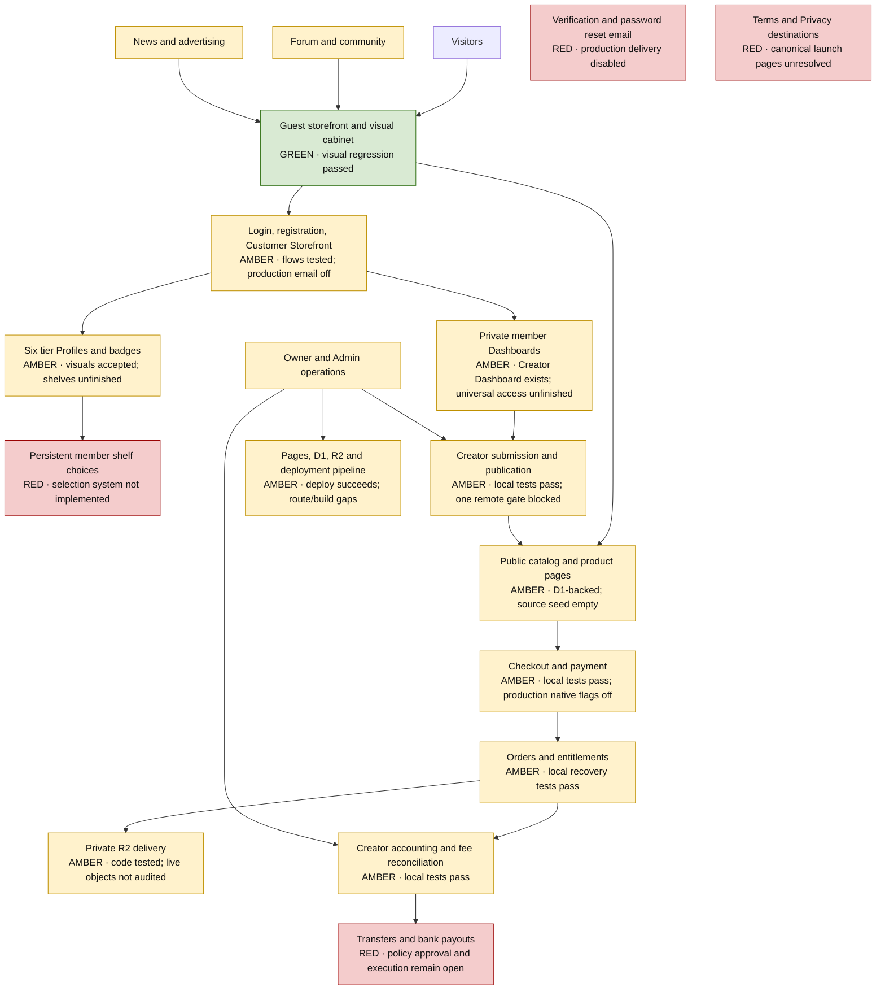

# Tobacco Road Games site build and business health audit

**Audited:** 2026-11-21  
**Repository:** canonical Tobacco Road Games workspace  
**Development revision:** f67f5932c5ce5dfc8622cdaadb098b8122d5587a  
**Scope:** Source-to-page generation, Cloudflare Pages packaging, Pages Functions compilation and routing, local launch regressions, and documented status of major business capabilities.  
**Production changes:** None. Cloudflare checks were metadata reads. The D1 database and R2 bucket contents were not queried or changed.

## Overall result

The repository builds and its launch test lane passed, but the Pages runtime route allowlist has three gaps. The production build also does not run the page generator, so generator changes require a separate generation step and updated checked-in output. The product JSON seed is empty, so a clean local build creates no static product detail pages and relies on the bound D1 catalog at runtime.

The production deployment remains successful and unchanged at deployment 266ae6d5-c699-4727-be58-1093c75cbac2, branch main, revision a0758e3. Cloudflare marks its source build dirty. The production Pages build command is npm run build:pages, with destination .wrangler/production-pages-output. That command packages files through scripts/build-pages-output.mjs. It does not invoke scripts/build-store.js.

Cloudflare recorded the development push as skipped, so no Preview or production build was made from audit revision f67f593. Regular staging remained at successful deployment 84b9483d-ec9c-47e1-995f-e8359316d277 on revision 4e311b84ad74d1b30637be8e2540db0e903b0a91.

## Build evidence

- Rebuilt from a disposable Git archive using node scripts/build-store.js. The generator completed and reported zero active source products.
- Prepared the Pages artifact with the configured packaging script. The archive contained 251 files and 50 HTML documents. It retained the six Profile routes.
- Compiled the Pages Functions source with Wrangler successfully.
- Rebuilt and compared 54 tracked generated HTML/XML files. Forty-two differed byte-for-byte. Thirty-seven differences were line endings. Five were content-level differences: root, Guest, and Customer storefront markup had whitespace-only changes, the catalog page differed only by a final newline, and the Store index carried newer cache-busting references when regenerated. No Profile structure changed after newline normalization.
- The three links found by the static-reference scan resolve through Cloudflare clean URLs or Pages Functions. The scan found no missing local assets or document routes.
- data/products.json contains an empty array. The generator creates zero static product detail pages. Product catalog and detail handlers read D1, so a runtime deployment needs the external D1 binding and production data.

### Build pipeline risk

Cloudflare's configured command runs only the packaging step. A change to scripts/build-store.js does not automatically update the tracked generated pages in guest/, customer.html, the six Profile entry points, and generated store pages. The rebuild found stale Store index asset-version query strings. The focused production release recipe under ops/releases/account-profile-072/ builds a separate candidate tree, but it is not the Cloudflare project's configured build command. Keep these build paths explicit in release operations.

The Function bundle is built separately by Cloudflare Pages. Its source is correctly absent from the static Pages directory produced by build-pages-output.mjs.

## Pages Function route gaps

_routes.json contains 50 included patterns. A scan of 89 concrete Function entry points found three handlers with no matching pattern:

| Handler | URL | Evidence and consequence |
| --- | --- | --- |
| functions/api/customer-remediation.js | /api/customer-remediation | The paid-order access page emits a form to this endpoint. Without a route include, the Function does not receive the request. |
| functions/creator-ad-media/[id].js | /creator-ad-media/<id> | assets/js/creator-dashboard.js requests this path for Creator ad previews, and the ad-rotation service emits it as a creative URL. The current /creator/* include does not cover the sibling /creator-ad-media/* path. |
| functions/api/account/addresses.js | /api/account/addresses | The authenticated saved-address handler has no include. No current client call was found in inspected browser code, so it is a dormant API gap until a caller is enabled. |

The launch suite passed despite these gaps because the relevant tests invoke handler modules directly. It does not currently assert that every concrete Pages Function route is covered by _routes.json.

## Local verification

npm run verify:launch finished with launch-critical PASS. It recorded 73 passed, 0 failed, 0 skipped, and 1 blocked. The storefront visual and Owner Intake Chromium checks passed. The blocked check is the remote-only Creator native-submission staging check, which requires staging D1/R2 and Wrangler bindings.

The aggregate suite covered the repository's main commerce, Creator, account, forum, catalog, and Owner paths. It is not a run of all 149 standalone test script files. The Pages Functions bundle also compiled successfully. This confirms local code paths and fixtures, not production transaction behavior.

## Major business component condition

Status meanings:

- **Green:** approved or locally verified for the named scope.
- **Amber:** implemented in part or depends on release, data, policy, or live-environment verification.
- **Red:** a known delivery blocker or unrouted runtime path exists.

## Component findings

### Storefront and merchandising — green

Guest remains the visual source. Customer is derived from Guest and protected by session middleware. The accepted cabinet assets remain in the source tree. Visual baselines passed. The Guest login popup and authenticated Customer navigation, Profile link, and logout flow are included in the accepted isolated Preview work.

The Open Rules shelf service is D1-configured, preserves configured order, and returns empty shelves rather than inventing a fallback catalog. Its local tests passed. The Guest and Customer shelf client paths are present.

### Catalog and Creator marketplace — amber

Catalog, Creator submission, Owner review, publication, ownership isolation, listing availability, and product-asset tests passed locally. Public catalog data and dynamic product pages are backed by D1. The checked-in JSON catalog is empty, so Git alone cannot reproduce current product listings. Runtime also requires its configured D1 and R2 resources.

The remote Creator staging test remained blocked. The missing Creator ad-media route include prevents those Function-backed preview images from working through the normal Pages router.

### Customer accounts and Profiles — amber

Shared account authentication and registration regressions passed. The Guest popup and authenticated Customer navigation work in the local browser gate. The six tier pages use the shared Profile Base and badge mappings. The six generated Profile pages remain temporary entry points.

Profile shelves intentionally stay empty. Persistent selection controls and storage are not implemented. The approved account architecture calls for a private Dashboard for each member and fresh authentication before Admin/Owner changes to another account. The Creator Dashboard is a separate surface. A universal member Dashboard and matching fresh-password administrative challenge were not found in the inspected routes and tests.

The /account.html management screen remains visually rejected in the continuity records. It is separate from the accepted Guest popup and Customer storefront.

### Checkout, payment, orders, and delivery — amber

Local checkout, order, Stripe webhook, entitlement, fulfillment recovery, free acquisition, and customer delivery regressions passed. The production Pages project has D1 and product R2 bindings. Production settings report NATIVE_LIVE_CHECKOUT_MODE=disabled, NATIVE_GUEST_CHECKOUT_MODE=disabled, and NATIVE_GUEST_CLAIM_MODE=disabled. The runtime Store kill-switch row and any production transaction were not queried in this audit.

The live production schema was last verified at migration 072. The approved account/Profile release has a separately rehearsed focused schema fragment. Development migrations 073–079 must not be bulk-applied to production for this release.

### Creator finance and payouts — amber/red

Native earnings, fee reconciliation, refund handling, ledger repair, and capacity tests passed locally. These are code and fixture results. The continuity record leaves transfer execution and payouts pending Owner decisions about loss liability, fees, refunds/disputes, supported regions and currencies, and funding/reconciliation. Passing accounting tests does not mean transfers are available.

### Owner, Admin, and Office operations — amber

Owner order recovery, pricing, publication, intake, store controls, and financial operations have local regressions. The local Owner Intake Chromium test passed. The production Pages binding metadata contains TRG_ORDERS and TRG_PRODUCTS, but no TRG_OFFICE or TRG_OFFICE_ARCHIVE. Those Office bindings appear in staging configuration. Production middleware redirects normal-host /office to the Office staging host, so Office availability depends on that separate environment.

Admin/Owner authorization exists for current management actions. A common member Dashboard and the approved fresh reauthentication gate for changing another member's account remain unverified.

### Forum, news, ads, and communications — mixed

Forum profile, categories, avatars, topics, replies, moderation, and rate-limit tests passed. Continuity documentation defers Forum product exposure until marketplace work is ready and says the account page still contains a Forum Profile panel that needs removal under the future account redesign.

News Chiron and homepage advertising tests passed locally. Advertising analytics protection is deferred. Creator ad media is affected by the missing Pages route include. Production account verification/reset email delivery is disabled by RESEND_DELIVERY_ENABLED=false.

### Policy and launch content — red

The project-state record says canonical Terms of Service and Privacy Policy pages/URLs remain unresolved even though registration stores consent. Premium Creator monthly/annual prices, excess catalog treatment at expiry, detailed Profile visibility rules, and Customer poster-frame behavior remain unresolved in the approved architecture.

## Documentation alignment

- docs/PRODUCT-SOURCE-OF-TRUTH.md names data/products.json as the catalog source of truth, but the file is empty and runtime catalog reads are D1-backed. Clarify the build seed versus runtime source.
- docs/R2-PRODUCT-ASSET-ROUTING.md says a manual dashboard R2 binding is required and no repository binding exists. The production Wrangler config and current Cloudflare metadata show TRG_PRODUCTS bound to trg-products. Update the stale instructions.
- docs/SITE-GEOGRAPHY.md reports verification against the recovery documentation revision rather than the current development commit. Refresh the verification note when maintaining continuity.
- docs/PROJECT-STATE.md is a chronological record with historical statements. Use its dated status labels when assessing current acceptance, and maintain a concise current release status near the top.

## Release readiness

**Not ready for an ordinary production replacement.** Production still serves a dirty a0758e3 deployment on schema 072. The Cloudflare build only packages current tracked generated pages. Production email is disabled, native checkout flags are disabled, the D1 schema for current account/marketplace code is behind development, and the exact live Functions bundle was unavailable for byte comparison in the prior reconciliation.

The focused account/Profile candidate was rehearsed locally against schema 072 plus its isolated SQL fragment. The rehearsal is separate from a deployed build and does not authorize production changes. Resolve the three route gaps and cover them with a Pages routing regression before the next runtime release.

## Reproduction commands

The full page generator ran only in a disposable Git archive under ignored .wrangler/site-build-audit/. The Pages packaging and Functions compilation outputs also stayed under .wrangler/. The launch report was written to .wrangler/site-build-audit-launch-verification.json. The audit did not modify production or regular staging resources.
